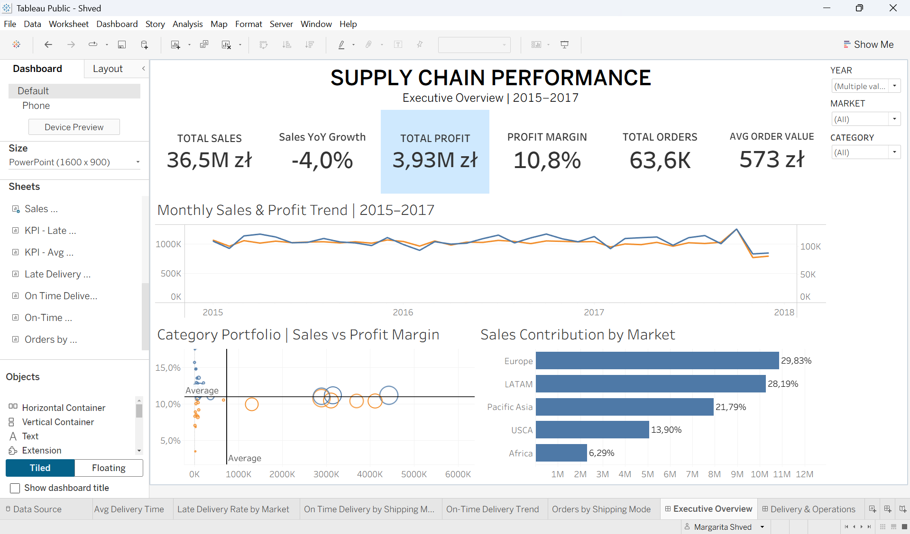

# Supply chain performance analysis (Tableau)

In this project I looked at a supply chain dataset from two sides: money (sales, profit, markets, categories) and delivery (how many orders arrive on time and what affects it). I built two Tableau dashboards and wrote down what I found and what I would recommend to the company.

## Data

Dataset: DataCo Smart Supply Chain for Big Data Analysis, downloaded from Kaggle. Original source: Constante, F., Silva, F., Pereira, A. (2019), Mendeley Data, https://doi.org/10.17632/8gx2fvg2k6.5 (licence CC BY 4.0).

I used orders from 2015 to 2017, so every year in the analysis is a full year and the YoY growth compares 2017 with 2016.

The dataset doesn't say which currency it uses. Most analyses of it treat the amounts as US dollars, so I do the same here.

The Tableau workbook is in this repo: [Supply Chain Performance Analysis_.twbx](Supply%20Chain%20Performance%20Analysis_.twbx). Download it and open it in Tableau Public or Tableau Desktop to use the filters and see the calculated fields.

## Dashboard 1: Executive Overview


KPI cards, monthly sales and profit trend, category portfolio (sales vs profit margin) and sales contribution by market. Filters: year, market, category.

Total sales are about $36.5M and profit is $3.93M, so the profit margin is 10.8%. There are 63.6K orders and the average order value is $573. The latest year-over-year sales growth is -4.0%.

## Dashboard 2: Delivery & Operations Performance



KPI cards, late delivery rate by market, on-time delivery by shipping mode, on-time delivery trend and orders by shipping mode. Filters: year, market, shipping mode.

Only 45% of orders are delivered on time. The other 55% are late. Average delivery time is 3.5 days.

## What I found

**The company makes a profit, but sales went down.** A 10.8% margin is fine, but -4.0% YoY growth is worth watching. If the trend continues, profit will drop too.

**Two markets bring most of the money.** Europe has 29.83% of sales and LATAM 28.19%, together about 58%. Pacific Asia has 21.79%, USCA 13.90% and Africa 6.29%.

**Monthly sales and profit go up and down, but there is no big fall over the period.** So the -4.0% is a slow decline, not a crash.

**High sales don't always mean high profit.** Some categories sell a lot but have average or lower margins. That's why I compared categories on both sales and profit, not revenue only.

**Late delivery is the biggest operational problem, and it's the same everywhere.** The late rate in every market is between 54.4% and 55.2%. The gap is less than one percentage point, so this is probably a problem in the whole fulfilment process, not in one region. The on-time rate also stays around 45% for the whole period and doesn't improve.

**Shipping mode makes the biggest difference:**

| Shipping mode | On-time delivery | Orders |
|---|---:|---:|
| Standard Class | 62% | 38,094 |
| Same Day | 54% | 3,451 |
| Second Class | 23% | 12,333 |
| First Class | 5% | 9,751 |

This surprised me the most. First Class should be the faster option, but only 5% of these orders arrive on time. Standard Class has the most orders and still the best result, so order volume alone doesn't explain the delays.

## What I would recommend

1. Look into First Class first. Maybe the promised delivery time is unrealistic, or the problem is in the warehouse, the carrier or route planning. The data shows the result, not the cause, so this needs checking with the operations team.
2. Find out what works in Standard Class and try to apply it to First Class and Second Class.
3. Treat delivery as a company-wide issue. Since all markets have almost the same late rate, fixing one region won't help much.
4. Set a target for on-time delivery and track it by shipping mode. 45% is the starting point.
5. Follow sales by market and category every month to see if the -4.0% is a short dip or a longer trend.
6. Check pricing, discounts and costs in the categories with high sales and low margins.

## Calculated fields

On-time and late delivery are based on the `Late_delivery_risk` column. The average of each field gives a percentage.

```
// On-Time Delivery
IF [Late_delivery_risk] = 0 THEN 1 ELSE 0 END

// Late Delivery
IF [Late_delivery_risk] = 1 THEN 1 ELSE 0 END

// Profit Margin
SUM([Benefit per order]) / SUM([Sales])

// Average Order Value
SUM([Sales]) / COUNTD([Order Id])

// Sales YoY Growth
(SUM([Sales]) - LOOKUP(SUM([Sales]), -1)) / ABS(LOOKUP(SUM([Sales]), -1))

// Category Performance (10.8% is the overall margin)
IF [Profit Margin] >= 0.108 THEN "Above Avg Margin" ELSE "Below Avg Margin" END
```

## Tools

Tableau: calculated fields, table calculations (LOOKUP for YoY), interactive filters, dashboard layout.

## Files

```
Supply-Chain-Performance-Analysis/
├── README.md
├── Supply Chain Performance Analysis_.twbx
├── executive overview.png
└── delivery-operations.png
```
